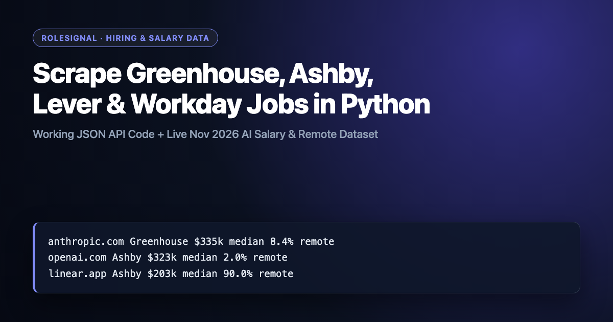

# Unified 6-ATS Jobs, Salary & Hiring Intelligence — REST API & MCP Server

[](https://glama.ai/mcp/servers/yun87457-web/ats-jobs-hiring-intel-mcp)
[](https://glama.ai/mcp/connectors/io.github.yun87457-web/ats-jobs-hiring-intel-mcp)
[](https://mcpservers.org/servers/yun87457-web/ats-jobs-hiring-intel-mcp)

Extract normalized job postings, parsed USD salary & equity ranges, workplace types (`remote`, `hybrid`, `onsite`), and `135+` JD tech-stack hiring signals across **Ashby, Greenhouse, Lever, SmartRecruiters, Workday, and BambooHR** from any company domain or work email.

### Job Freshness Buckets, Workday Upper-Bound Hardening & Truncation Transparency (`v1.1.4`)
- **Filter out ghost-job boards:** Every job record emits `postedDaysAgo`, `freshnessStatus` (`active_7d` | `recent_30d` | `aged_30plus` | `aged_90d` | `stale` | `unknown`), and a deterministic `jobFingerprint` (16-hex SHA-256 of `company|title|dept|location`) so longitudinal pipelines can flag bumped/republished reqs even when `publishedAt` resets.
- **Workday dedupe & `30+` date hardening:** Keys primarily on `externalPath` (preserving multi-location/repost suffixes like `JR2030393-1`), stores digit-validated `bulletFields` separately as `requisitionId` (rejecting non-ID strings like `"Full time"`), and keeps `"Posted 30+ Days Ago"` in `postedAtUpperBound` / `postedDateIsUpperBound: true` (`aged_30plus`) so evergreen roles never pollute `freshJobs30d`.
- **Summary denominator & truncation transparency:** Company summaries (`summaryMode: true` / `/screen`) expose `boardTotalJobs`, `isTruncated`, `salaryCoveragePct`, `freshJobs7d`, `freshJobs30d`, `newestJobDaysAgo`, `hiringActivityStatus`, and `boardMatchConfidence` (`high` | `medium` | `none`, `0.00–1.00`).

## Access Channels

- **Apify Store (Batch + Standby + 5,000 Free Jobs/mo):** https://apify.com/spiky_closet/ats-jobs-hiring-intel
- **RapidAPI Hub (REST API, Free Basic Plan):** https://rapidapi.com/HYunLe/api/unified-multi-ats-jobs-salary-hiring-intelligence
- **Official MCP Registry:** `io.github.yun87457-web/ats-jobs-hiring-intel-mcp`

## Verified Performance (50-Company Batch Benchmark)

- **50 mixed companies (`summaryMode: true`):** `42.42 s` runtime, `113.3 MB` peak RAM, `0` errors, automatic deduplication, word-boundary keyword exclusions, and `$0` billing on unfound/non-ATS domains.

## MCP Tools (Streamable HTTP)

Endpoint: `https://spiky-closet--ats-jobs-hiring-intel.apify.actor/mcp`

| Tool | Description |
|---|---|
| `detect_company_ats` | Auto-detect which of the 6 ATS platforms a company uses from a domain or work email (`<400 ms`). |
| `get_company_jobs` | Fetch and filter open roles by `titleKeywords`, `keywords`, `excludeKeywords`, `remoteOnly`, `minSalaryUsd`, `postedWithinDays`, and `mustMentionTech`. |
| `screen_hiring_signals` | Batch score multiple companies by open role count, median USD salary, remote share, department mix, and top tech stack signals. |

## Claude Desktop / Cursor MCP Configuration

```json
{
  "mcpServers": {
    "ats-jobs-hiring-intel": {
      "url": "https://spiky-closet--ats-jobs-hiring-intel.apify.actor/mcp",
      "headers": {
        "Authorization": "Bearer YOUR_APIFY_TOKEN"
      }
    }
  }
}
```

## REST Quick Start (cURL)

```bash
curl -s -X POST "https://unified-multi-ats-jobs-salary-hiring-intelligence.p.rapidapi.com/screen" \
  -H "x-rapidapi-key: YOUR_RAPIDAPI_KEY" \
  -H "x-rapidapi-host: unified-multi-ats-jobs-salary-hiring-intelligence.p.rapidapi.com" \
  -H "Content-Type: application/json" \
  -d '{"companies": ["ramp.com", "datadoghq.com", "stripe.com"]}'
```

## Free n8n Workflow Template

Import the ready-to-run workflow (**Weekly 6-ATS Hiring Velocity, Salary & JD Tech Signal Monitor**): [`n8n-template.json`](./n8n-template.json)

1. Download [`n8n-template.json`](./n8n-template.json) and click **Import from File** in n8n.
2. Add a Generic Header Auth credential (`x-rapidapi-key`) using your free RapidAPI key.
3. Replace the sample domain list and connect your Slack channel.

## Ready-to-Run Presets (Apify Public Tasks)
- [Ashby Job Board, Salary & Tech Stack Scraper](https://apify.com/spiky_closet/ats-jobs-hiring-intel/examples/ashby-job-board-salary-scraper)
- [Greenhouse Careers, Salary & Hiring Signal Scraper](https://apify.com/spiky_closet/ats-jobs-hiring-intel/examples/greenhouse-careers-hiring-scraper)
- [Multi-ATS Company Hiring Velocity & Tech Summary](https://apify.com/spiky_closet/ats-jobs-hiring-intel/examples/multi-ats-hiring-velocity-summary)
## Live Interactive Top-100 Benchmark (Nov 2026)

Explore our live open dataset of **81 active AI, DevTools & Fintech startup ATS boards (`9,556` live open roles)** scraped in `11.85s`:
- **Interactive Web Explorer:** https://yun87457-web.github.io/ats-jobs-hiring-intel-mcp/
- **Open Downloads (MIT):** [`benchmarks/top-100-nov-2026.csv`](./benchmarks/top-100-nov-2026.csv) · [`benchmarks/top-100-nov-2026.json`](./benchmarks/top-100-nov-2026.json)
- **Key Findings:** Ashby leads Greenhouse (`46` vs `31`) among modern AI/Dev startups; `74/81` (`91%`) publish USD salary bands (Anthropic `$335k` median vs OpenAI `$323k` median).

## Install & Run Locally (Stdio MCP Server — Zero Dependencies)

Run directly in Claude Desktop, Cursor, Windsurf, or Cline using Node.js 18+ (supports either `APIFY_TOKEN` or `RAPIDAPI_KEY`):

```bash
npx -y github:yun87457-web/ats-jobs-hiring-intel-mcp
```

```json
{
  "mcpServers": {
    "ats-jobs-hiring-intel": {
      "command": "npx",
      "args": ["-y", "github:yun87457-web/ats-jobs-hiring-intel-mcp"],
      "env": { "RAPIDAPI_KEY": "YOUR_FREE_RAPIDAPI_KEY" }
    }
  }
}
```

## No-Code Recipes (n8n, Make.com & Clay)

- **n8n Workflow JSON:** [`n8n-template.json`](./n8n-template.json) (and community node scaffold in [`n8n-community-node/`](./n8n-community-node/))
- **Clay HTTP Enrichment:** [`integrations/clay-http-enrichment.json`](./integrations/clay-http-enrichment.json)
- **Make.com HTTP Module:** [`integrations/make-http-module.json`](./integrations/make-http-module.json)
